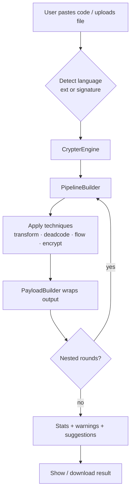
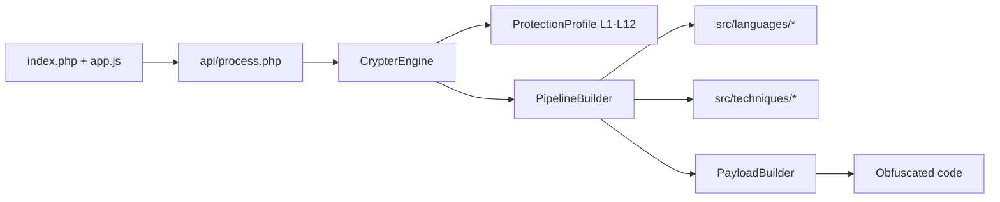

# 🛡️ Crypter0

## Advanced Code Obfuscation Engine


> **Turn readable source code into a hard-to-read payload — with one click.**

| 🌐 Web UI | 🔌 REST API | 🔁 Nested encryption | 🧩 12 presets | 📊 Live stats |
|-----------|-------------|----------------------|----------------|----------------|

---

## 📑 Table of contents

- [✨ Why Crypter0?](#-why-crypter0)
- [🚀 Install](#-install)
- [🖥 How to use](#-how-to-use)
- [📊 Diagrams](#-diagrams)
- [🧠 How it works](#-how-it-works)
- [🔌 API](#-api)
- [🧩 Protection levels](#-protection-levels)
- [⌨️ Shortcuts](#%EF%B8%8F-shortcuts)
- [🗃 Git details](#-git-details)
- [🛠 Development](#-development)

---

## ✨ Why Crypter0?

| Feature | Detail |
|---|---|
| 🌍 **35+ languages** | Auto-detected by filename or code signature |
| 🧪 **20+ techniques** | Mix and match in a custom pipeline |
| 🔒 **12 levels** | `L1 Minimal` → `L12 Ultimate` |
| 🔁 **Nested rounds** | Up to 5 layers of re-encryption |
| 📈 **Live stats** | Size, ratio, entropy, strength |
| ⚡ **Zero setup** | Pure PHP + vanilla JS — no Composer, no DB |

---

## 🚀 Install

### 1. Copy project to htdocs

```
/opt/lampp/htdocs/Crypter0
```

### 2. Start Apache

```bash
sudo /opt/lampp/lampp startapache
```

### 3. Open in browser

```
http://localhost/Crypter0/
```

### ✅ Install checklist

- [ ] XAMPP / LAMPP installed
- [ ] Project copied into `htdocs/Crypter0`
- [ ] Apache running
- [ ] Page opens at `http://localhost/Crypter0/`

**Requirements:** PHP 8.x · XAMPP/LAMPP · No database · No Composer

---

## 🖥 How to use

1. Paste code or drop a file.
2. Pick a **language** (or use **Auto Detect**).
3. Choose a **protection level** or build a **custom pipeline**.
4. Press **▶ Build** or `Ctrl+Enter`.
5. Copy / download the obfuscated output.

💡 **Tip:** use **Advanced → Re-Encrypt** to wrap the output multiple times.

---

## 📊 Diagrams

### Full flow



### Architecture



---

## 🧠 How it works

```
input code
   → detectLanguage()
   → CrypterEngine
       → PipelineBuilder: apply techniques in order
           → PayloadBuilder wraps result
               → repeat for N nested rounds
               → return code + stats + warnings + suggestions
```

- **Detection** — filename extension first, then regex signatures.
- **Pipeline** — categories like `transform`, `deadcode`, `controlflow`, `opaque`, `strencrypt`, `anti`, `antiai`, `polymorphic`.
- **Wrappers** — forced last so the final payload stays executable.
- **Validation** — invalid combos are filtered for compiled/eval-less languages.

**Wrapper languages:** `python`, `javascript`, `typescript`, `php`, `ruby`, `perl`, `bash`, `lua`, `go`, `csharp`, `java`, `kotlin`, `scala`.

---

## 🔌 API

### `POST /api/process.php`

| Field | Type | Notes |
|---|---|---|
| `code` | string | Source code, or upload `file` |
| `lang` | string | `auto` or a language id |
| `filename` | string | Used for detection & download name |
| `pipeline` | JSON | Array of `{category, technique, options}` |
| `level` | int | `1–12`, used when `pipeline` is empty |
| `nest` | int | Nested rounds `1–5` |
| `output_mode` | string | `auto` / `text` / `file` |

**Response:** `{ success, code, language, original_size, final_size, expansion_ratio, entropy, steps, rounds, download, mime, ext, warnings, suggestions }`

### Other endpoints

| Endpoint | Method | Returns |
|---|---|---|
| `/api/analyze.php` | POST | `{ language, lines, size, entropy, suggestions }` |
| `/api/presets.php?level=3&lang=python` | GET | `{ name, pipeline }` |
| `/api/download.php` | POST | File attachment |

---

## 🧩 Protection levels

| Level | Name | Highlights |
|:---:|---|---|
| L1 | Minimal | stub wrap only |
| L2 | Light | + variable rename |
| L3 | Basic | + light dead code |
| L4 | Standard | + basic control flow flattening |
| L5 | Enhanced | + instruction substitution |
| L6 | Advanced | + opaque predicates + string-array XOR |
| L7 | Enterprise | + XOR string encryption + decompose + anti-debug |
| L8 | Hardened | + full control flow + anti-AI + polymorphic + watermark |
| L9 | Extreme | + anti-tamper |
| L10 | Maximum | + layered encryption (3) + noise inject |
| L11 | Paragon | + VM detect + extreme opaque predicates + trace mark |
| L12 | Ultimate | max baseline, same as Paragon |

---

## ⌨️ Shortcuts

| Keys | Action |
|---|---|
| `Ctrl+Enter` | Build |
| `Ctrl+Z` / `Ctrl+Y` | Undo / Redo |
| `Esc` | Close modal |
| `?` | Show shortcuts |

---

## 🗃 Git details

- **Branch:** `master`
- **Head commit:** initial commit
- **Committed:** 2026-10-13 (+08:00)
- **Size:** 69 files · ~6.9k lines
- **Tests:** none bundled; lint with `php -l`

---

## 🛠 Development

- **Autoload:** `autoload.php` maps `src/{core,languages,techniques,utils}/ClassName.php`
- **Add language:** create `src/languages/FooCrypter.php`, register in `detectLanguage()` and `PayloadBuilder`
- **Add technique:** create `src/techniques/Foo.php`, wire case in `PipelineBuilder::applyStep()`
- **Lint:** `/opt/lampp/bin/php -l file.php`

---

> ⚠️ Crypter0 is a development / educational tool. Respect the licenses of code you process.
